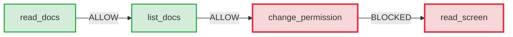
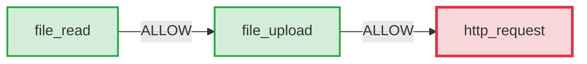

# Behavior-Chain Security Analysis of Dify Agent Tool Invocation

> Independent security research · White-hat perspective · November 2026

---

## Summary

Dify is a well-engineered LLM application platform. This report focuses on one specific dimension — **behavior-chain security of Agent tool invocation** — and shares findings and suggestions in the spirit of community contribution.

The core observation:

> **Content moderation governs what an Agent *says*; behavior-chain security governs what an Agent *does*.**

Dify's Agent applications allow an LLM to autonomously invoke tools. An individual tool call is often harmless, but a **chain of tool calls can constitute an attack** that neither content moderation nor single-step rules can catch.

---

## Findings

Dify exposes 50+ built-in tools plus custom tools (OpenAPI) and MCP tools. Among them, the following are high-risk when chained:

| Tool | Capability | Chained risk |
|---|---|---|
| Code execution (Sandbox) | Run Python/Node.js | Read arbitrary files, env vars, secrets |
| HTTP request | Request any URL | Exfiltrate data to any endpoint |
| File storage (S3/OSS) | Upload/download/list | Move internal files outside |
| Email / SMS | Send messages | Leak content to third parties |

Individually these are legitimate capabilities. When combined by a crafted prompt, they form exfiltration chains.

## Two Representative Attack Patterns (sanitized)

### Pattern 1 — Progressive Privilege Escalation

The first two turns look legitimate; the privilege escalation is caught only by lineage-level (privilege-decreasing) checks, not by single-step rules.

### Pattern 2 — Covert Credential Exfiltration

Each step looks like a normal file operation; chained together they form a "read → upload → exfiltrate" credential-leak path.

---

## Recommendations

These are suggestions for strengthening the behavior-chain dimension of Dify Agent security:

1. **Tool-call chain auditing** — Evaluate the *sequence* of tool invocations, not just each tool in isolation. A chain like `file_read → file_upload → http_request` is harmless step-by-step but dangerous as a whole.

2. **Contract-level constraints** — Let developers declare, upfront, what an Agent may access (`scope`) and must never do (`constraints`, e.g. no egress). Contract violations are more reliable than post-hoc blacklists.

3. **Sensitive-resource monitoring** — Separately alert on access to `.env`, key files, and certificates, even when the invoking tool is otherwise authorized.

4. **Privilege-decreasing lineage** — When an Agent spawns sub-agents, their permissions should only decrease, never increase. This blocks progressive privilege escalation across turns.

---

## About This Research

This analysis was performed in an offline, isolated environment using a behavior-chain security engine (with a private red-team sample library). Details of prompts and playbooks are intentionally omitted.

We welcome discussion. If your team would like a deeper, log-based red-team assessment for Dify, Coze, or a custom agent framework, feel free to reach out.

**Contact:** security@starring-ai-sec.com

---

*Open-source baseline (for independent verification of basic behavior-chain detection): https://github.com/starring-ai-sec/star-ring-agent-sentinel*
