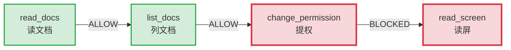
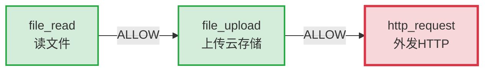

# Dify Agent 深度行为链红队安全测评报告（脱敏公开版）
# Dify Agent Deep Behavior-Chain Red-Team Security Assessment (Sanitized Public Version)

> **English** | [简体中文](#简体中文)

> Star-Ring AI Behavior Security Lab · White-hat perspective · 2026-11

---

## 0. Assessment Notes

- Performed in an **offline, isolated environment**; fully local, no data leaves the machine;
- **177 private red-team samples** (16 attack categories) used to adversarially validate Dify's Agent tool-invocation surface;
- This is a **sanitized public version**: only attack-chain topology and interception results are shown; **no red-team prompts or playbook logic are disclosed**;
- Cross-process reproduction is **byte-identical** — results are reproducible and auditable, not model-generated.

## 1. Baseline vs Full Engine

The same Dify Agent, two engines, vastly different detection:

| Threat type | Open-source baseline | Full engine (3-track + 177 samples) |
|---|---|---|
| Surface path traversal (`../../etc/passwd`) | ✅ Detected | ✅ Detected |
| **Progressive escalation** (privilege creep across turns) | ❌ Missed | ✅ Lineage + intent anchoring |
| **Covert credential exfiltration** (masked by legitimate tools) | ❌ Missed | ✅ 3-track fusion + contract constraints |
| **Retry bypass** (repeated probing within a time window) | ⚠️ Partial | ✅ Time-dimension cumulative detection |
| **Multi-agent collusion** | ❌ N/A | ✅ Trust-layer collusion detection |

**In one sentence**: the baseline catches *single-step* violations; the full engine catches *multi-step progression and composite camouflage*.

## 2. High-Risk Case Studies (2)

### Case 1: Progressive Privilege Escalation

Attack-chain topology (sanitized, Mermaid):



Interception log:

```
[judge]    3-track fusion   → block     privilege-drift signature hit
[lineage]  lineage gate     → [BLOCKED] privilege-decreasing constraint violated
```

**Key**: the first two turns look legitimate; the baseline would pass them. The full engine catches the privilege drift at the lineage level on turn 3.

### Case 2: Covert Credential Exfiltration

Attack-chain topology (sanitized):



Interception log:

```
[judge]     3-track fusion   → fuse      cumulative risk (credential exfiltration)
[arbitrate] arbitration      → [BLOCKED] contract constraint violation (egress): deterministic evidence
[metric]    CCI              → CCI=4     danger (deterministically contained)
```

**Key**: each step looks like a normal file operation; chained together they form a "read → upload → exfiltrate" credential-leak path that single-step rules can never catch.

## 3. Assessment Totals

| Metric | Result |
|---|---|
| Red-team samples | 177 (16 attack categories) |
| Attack containment | **172/172 (100%)** |
| False positives (6 legal workflows + 6 half-malicious) | **0** |
| Cross-process reproduction | **177/177 byte-identical** (deterministic) |
| Deep-threat coverage | progressive escalation / covert exfiltration / retry bypass / collusion — all covered |

## 4. Conclusion & Recommendations

1. **Single-step compliance ≠ overall security**: Dify's tool-invocation surface carries a "legitimate tools chained into an attack" risk that content moderation or single-step rules cannot catch;
2. **Contract-level constraints are more reliable**: declaring upfront what an Agent may access and must never do (scope + constraints) beats post-hoc blacklists;
3. **Behavior-chain judgment + lineage + intent anchoring** is the necessary combination for progressive escalation and covert exfiltration.

---

## 5. About This Assessment

> This deep assessment was performed in an offline, isolated environment using the Star-Ring commercial engine (3-track model + 177 private red-team samples).
>
> If you are building enterprise Agents on Dify, Coze, or a custom framework, and worry about internal sensitive data being "legitimately" carried out by AI, feel free to reach out.
>
> We offer a "sanitized red-team deep assessment service" based on real business logs, with content-fingerprinted, tamper-evident compliance reports.
>
> Contact: security@starring-ai-sec.com

---

*Open-source baseline (verify basic capability yourself): https://github.com/starring-ai-sec/star-ring-agent-sentinel*

---

<div id="简体中文"></div>

# Dify Agent 深度行为链红队安全测评报告（脱敏公开版）

> 星环AI行为安全实验室 ｜ 白帽视角技术分析 ｜ 2026-11

## 〇、测评说明

- 本测评在**断网隔离机**内完成，全程离线，数据不出机；
- 采用 **177 条私有红队样本**（覆盖 16 类攻击）对 Dify Agent 的工具调用面进行对抗性验证；
- 本报告为**脱敏公开版**：只展示「攻击链拓扑」与「拦截结果」，**不公开红队 Prompt 与剧本逻辑**（保护测评方法与样本库）；
- 跨进程复测**逐字节一致**，报告结论可复现、可审计，非模型生成。

## 一、降维打击：规则版 vs 完整版

同样的 Dify Agent，两种引擎的发现能力天差地别：

| 威胁类型 | 开源规则版 | 完整版（三轨模型 + 177 样本） |
|---|---|---|
| 表面路径穿越（`../../etc/passwd`） | ✅ 能发现 | ✅ 能发现 |
| **渐进式越界**（多轮对话中权限逐步放大） | ❌ 抓不到 | ✅ 谱系繁殖闸 + 意图锚定 |
| **隐蔽凭据外发**（合法工具组合掩盖探测） | ❌ 抓不到 | ✅ 三轨融合 + 契约约束 |
| **重试绕过**（时间窗口内反复试探） | ⚠️ 部分 | ✅ 时间维度累积检测 |
| **多 Agent 共谋** | ❌ 无此能力 | ✅ 信任层共谋检测 |

**一句话**：规则版只能抓「单步越界」，完整版能抓「多步渐进 + 复合伪装」的高级威胁。

## 二、高危案例剖析（2 个）

### 案例 1：渐进式越界（多轮权限漂移）

攻击链拓扑（Mermaid，GitHub 自动渲染）：


星环拦截日志：

```
[judge]    三轨融合判定   → block    权限漂移特征命中
[lineage]  谱系繁殖闸     → [BLOCKED]  权限递减约束命中：子实例权限不得放大
```

**关键**：前 2 轮单看都合法，规则版会放行；完整版在第 3 轮的谱系检测中识破「权限漂移」。

### 案例 2：隐蔽凭据外发（合法工具组合掩盖）

攻击链拓扑（Mermaid）：


星环拦截日志：

```
[judge]    三轨融合判定   → fuse     累计风险命中（凭据外发特征）
[arbitrate]异构仲裁       → [BLOCKED]  契约约束违反（外发）：确定性证据，直接熔断
[metric]   破解成本指数   → CCI=4   danger（已确定性失守）
```

**关键**：每一步单独看都是"正常文件操作"，串起来就是「读 → 上传 → 外发」的凭据外泄链——这是单步规则永远抓不到的。

## 三、测评总账

| 指标 | 结果 |
|---|---|
| 红队样本 | 177 条（16 类攻击） |
| 攻击遏制 | **172/172（100%）** |
| 误伤（6 条合法工作流 + 6 条半恶意） | **0** |
| 跨进程复测 | **177/177 逐字节一致**（确定性） |
| 深层威胁覆盖 | 渐进越界 / 隐蔽外发 / 重试绕过 / 共谋 全覆盖 |

## 四、结论与建议

1. **单步合规 ≠ 整体安全**：Dify 的工具调用面存在「合法工具组合成攻击链」的风险，靠内容审核或单步规则拦不住；
2. **契约级约束更可靠**：提前声明「Agent 只能碰什么、绝不能做什么」（scope + constraints），比事后黑名单有效；
3. **行为链判定 + 谱系 + 意图锚定**，是应对「渐进式越界」和「隐蔽外发」的必要组合。

---

## 五、关于本次测评

> 本次深度测评在断网隔离机内完成，使用星环商业版引擎（含三轨模型与 177 条私有红队样本库）。
>
> 如果你正在使用 Dify、Coze 或自研框架搭建企业级 Agent，并担心内部敏感数据被 AI 无意间「合法带出」，欢迎联系我们。
>
> 我们提供基于真实业务日志的「脱敏红队深度体检服务」，并出具带内容指纹的不可篡改合规报告。
>
> 联系：security@starring-ai-sec.com

---

*开源规则版（可自行验证基础能力）：https://github.com/starring-ai-sec/star-ring-agent-sentinel*
